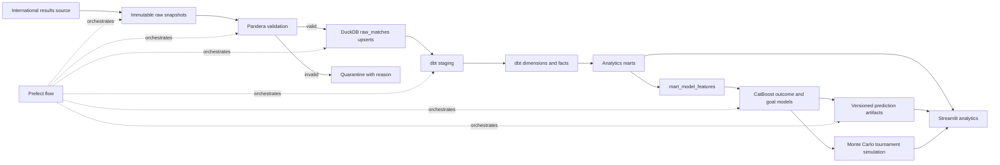

# World Cup 2026 Data Platform and ML Predictor

[Open the Streamlit dashboard](https://adeoluwa-4-wc26-predictor-streamlit-app-awcr9s.streamlit.app)

An end-to-end football data platform that turns international match results into governed analytics tables, leakage-safe CatBoost features, match probabilities, and Monte Carlo World Cup simulations. The system keeps the original tournament engine and dashboard while making the data lineage explicit and testable.

## Architecture



## Data flow

1. The latest `results.csv` is copied into a timestamped, checksum-addressed raw snapshot. Existing snapshots are never overwritten.
2. Pandera checks required fields, dates, score bounds, and team validity. Failed rows are written to `data/quarantine/<run_id>.parquet` with a reason.
3. Valid rows retain their original source values, receive canonical names and a score-independent stable match key, and are upserted into DuckDB. A source watermark supports incremental reruns; explicit date ranges support corrections and backfills.
4. dbt builds staging, intermediate, dimension, fact, and analytics models, runs 35 uniqueness/null/relationship/accepted-value tests, and enforces a separate raw-source freshness check.
5. The Python feature builder preserves strict prior-date Elo/FIFA joins, same-date-safe rolling form, H2H priors, and chronological train/validation/test splits. Its output is registered as `analytics.mart_model_features`.
6. CatBoost training reads the dbt mart, not raw CSVs. Metadata records split sizes, feature count, metrics, duration, source snapshot, model version, and artifact checksums.
7. The existing official-format tournament simulation repeatedly samples model probabilities. Streamlit reads analytics marts and versioned model metadata while preserving the interactive match, group, bracket, and title-odds views.

## Warehouse layers

| Layer | Relations | Purpose |
|---|---|---|
| Raw | `raw_matches`, `raw_model_features`, `pipeline_runs`, `ingestion_checkpoints`, `quarantined_records` | Traceable ingestion, run state, and validated inputs |
| Staging | `stg_matches` | Typed and normalized match records with original source fields |
| Intermediate | `int_team_match_history` | One team-side row per match for reusable analytics |
| Dimensions | `dim_team`, `dim_tournament`, `dim_date` | Conformed entities and calendar attributes |
| Facts | `fact_match`, `fact_team_ranking`, `fact_team_form` | Match outcomes, prior rankings, and leakage-safe form |
| Marts | `mart_team_performance`, `mart_model_features`, `mart_predictions` | Dashboard analytics, CatBoost contract, and published-run metadata |

See [docs/data_dictionary.md](docs/data_dictionary.md) for field-level definitions and lineage.

## Local setup

Python 3.10+ is required. Python 3.12 is used in the verified local run.

```bash
python3 -m venv .venv
source .venv/bin/activate
python -m pip install -r requirements.txt
```

The repository tracks a compact leakage-safe training parquet and trained artifacts. Complete Elo and FIFA raw histories are intentionally not committed. When those optional histories are absent, a clean checkout uses the documented incremental profile fallback and only appends scored matches newer than the tracked feature watermark.

## Commands

```bash
# Normal incremental refresh through dbt, without retraining
make refresh PYTHON=.venv/bin/python

# Historical correction/backfill, inclusive dates
make backfill START=2024-01-01 END=2024-12-31 PYTHON=.venv/bin/python

# Rebuild every dbt analytics model
make rebuild PYTHON=.venv/bin/python

# Train CatBoost from analytics.mart_model_features
make train PYTHON=.venv/bin/python

# Complete ingest -> validation -> warehouse -> dbt -> train -> publish flow
make pipeline PYTHON=.venv/bin/python

# Python and dbt verification
make test PYTHON=.venv/bin/python
make dbt-test

# Dashboard
make dashboard PYTHON=.venv/bin/python
```

The same stages are available as a Prefect flow:

```bash
python -m src.platform.orchestration
```

## Incremental loading and corrections

- `ingestion_checkpoints` stores the latest source watermark and snapshot checksum.
- Normal refreshes re-read the watermark date so late same-day rows and corrections can upsert safely.
- Stable keys exclude scores, allowing a corrected result to update the existing match instead of creating a duplicate.
- Genuine same-day repeat fixtures are separated with `match_occurrence` and city lineage.
- `backfill --start --end` bypasses the normal watermark and upserts the requested historical range.
- Rerunning the same source is idempotent because `match_key` is the warehouse primary key.

## Failure recovery

Every run is inserted into `pipeline_runs` as `running` and finalized as `success` or `failed` with row counts and an error message. Raw snapshots and quarantined records remain available for diagnosis. After fixing a source or code issue, rerun the same incremental command; upserts make replay safe. For an older correction, use a bounded backfill. dbt models can be rebuilt independently with `make rebuild`.

## Automation status

`.github/workflows/update-after-matchday.yml` contains a weekly Monday 06:00 UTC schedule and a manual backfill path. The complete pipeline has been verified locally. The hosted GitHub Actions schedule is configured but is not claimed as verified until its first successful remote run. No cloud warehouse or BigQuery execution is claimed; DuckDB is the verified local warehouse.

## Testing and measured results

The latest local verification report is in [docs/verification_report.md](docs/verification_report.md). The run covered stable keys, normalization, deduplication, incremental loading, backfills, quarantine, strict prior-date features, official tournament routing, model generation, dbt relationships, and mart uniqueness.

## Known limitations

- The public repository does not include the full raw Elo/FIFA source histories, so clean-checkout feature rebuilding uses the tracked feature base and saved pre-match profiles.
- A local DuckDB file is not designed for concurrent writers; pipeline stages close the loader connection before dbt runs.
- The configured GitHub schedule still needs a successful hosted run before it can be described as operational.
- The local Streamlit server passed an HTTP health check, but the live deployment was not redeployed or browser-tested as part of this verification.
- Predictions are probabilistic estimates, not guaranteed outcomes.

## Resume bullets

- Built a DuckDB/dbt football platform that produced 11 analytics models with 46 passing build checks by validating and modeling 49,547 international match records through an automated pipeline.
- Achieved 63.3% held-out match-outcome accuracy across 237 test matches by engineering a leakage-safe 54-feature CatBoost mart with chronological splits and checksum-versioned artifacts.
- Prevented duplicate growth across a verified replay of 49,547 source records by implementing score-independent match keys, watermark-based incremental upserts, bounded backfills, and persisted Prefect run state.
